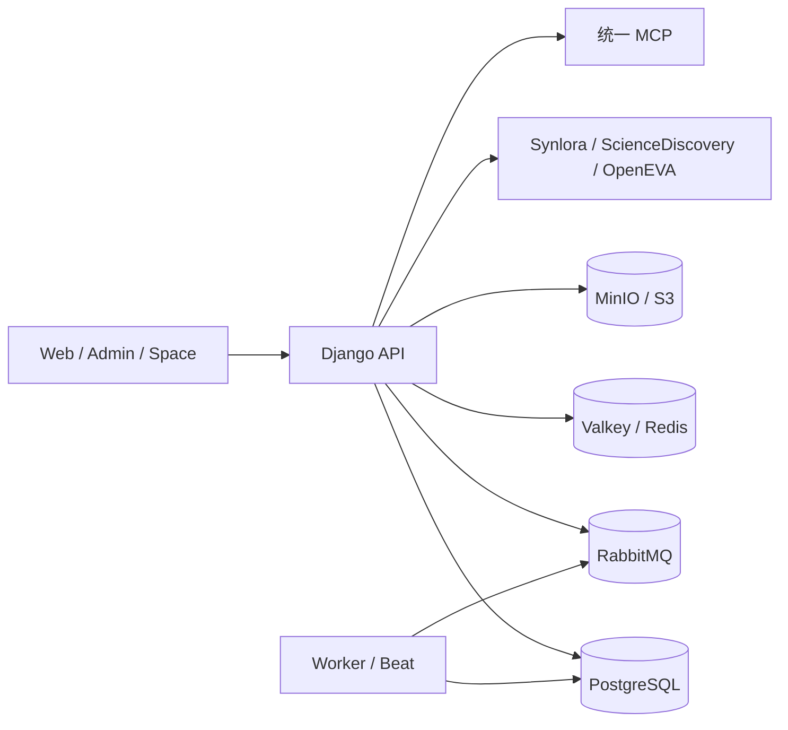

# PiLab

> 面向高校科研与新型研发机构的科研及办公协同平台

[](https://github.com/SynlysAI/plane)
[](https://github.com/SynlysAI/plane/tree/develop)
[](LICENSE.txt)

PiLab 是 [SynlysAI](https://github.com/SynlysAI) 基于开源项目 [Plane](https://github.com/makeplane/plane) 二次开发的科研与办公管理平台，也是 [AI4MS](https://ai4ms.xmuzc.com/) 统一研发门户的协同管理模块。

它把工作项、项目、周期、页面、审批、研究链、报告、附件和智能体连接到同一个可追溯工作空间，适用于高校院系、重点实验室、新型研发机构和研发团队。项目支持私有化部署，科研模块可以按部署级和工作区级开关逐层启用。

## 项目入口

| 入口            | 地址                                 |
| --------------- | ------------------------------------ |
| SynlysAI 官网   | <https://synlysai.xmuzc.com/>        |
| AI4MS 统一门户  | <https://ai4ms.xmuzc.com/>           |
| SynlysAI GitHub | <https://github.com/SynlysAI>        |
| PiLab 仓库      | <https://github.com/SynlysAI/plane>  |
| 上游 Plane      | <https://github.com/makeplane/plane> |

## 核心能力

### Plane 协作基础

- 工作区、项目、工作项、子工作项、标签、评论和附件
- 周期（Cycles）、模块（Modules）、视图（Views）和分析
- 页面（Pages）、富文本编辑、版本记录和实时协作
- 工作区成员、项目角色、组织归属、通知和系统管理

### 科研与办公工作台

- 科研项目与行政项目双通道，以及组织和项目分类管理
- 研究链阶段、节点任务、材料快照、审批、评审和过程记录
- 研究报告、周期汇报、论文评审、成果附件与知识关联
- 首页工作台、统一待办、审批中心和按角色投影的工作入口
- 行政项目成员、配置权限、会议决议和跨部门协作

### AI 与 MCP 集成

- 通过 Synlora、ScienceDiscovery 和 OpenEVA 接入智能体运行时
- 统一 MCP 连接管理、授权、读写工具和审计边界
- 周报智能体支持草稿、正式提交、正文读取和结果回填
- 科研上下文、知识引用、节点操作和外部系统连接支持降级策略

### 私有化与安全

- Docker Compose 提供 API、Worker、定时任务、PostgreSQL、Redis、RabbitMQ、MinIO 和附件预览服务
- 支持 OIDC、工作区权限、科研角色、上下文令牌和操作审计
- 文件上传按大小、MIME、签名和外部转换服务策略校验
- 科研模块默认关闭，未启用时不改变 Plane 核心协作能力

## 系统结构



主要目录：

| 目录          | 职责                                       |
| ------------- | ------------------------------------------ |
| `apps/web`    | 主工作台和科研界面                         |
| `apps/admin`  | 实例管理端（God mode）                     |
| `apps/space`  | 空间入口                                   |
| `apps/live`   | 实时协作服务                               |
| `apps/api`    | Django API、数据模型、权限、科研服务和 MCP |
| `packages/*`  | 前端共享组件、类型、服务和编辑器包         |
| `deployments` | 镜像、代理和部署配置                       |
| `demos`       | MCP 与外部智能体示例                       |
| `docs`        | 产品、架构、契约、运维和发布文档           |

## 当前状态

| 项目     | 当前值                                        |
| -------- | --------------------------------------------- |
| 软件版本 | `8.11.1`                                      |
| 默认分支 | `develop`                                     |
| 上游项目 | Plane，保留其项目管理核心模型和工作流基础     |
| 科研模块 | 部署级 `RESEARCH_MODULE_ENABLED=0` 时默认关闭 |
| 许可证   | [AGPL-3.0](LICENSE.txt)                       |

`develop` 是持续集成和功能交付分支。科研模块已经覆盖研究链、报告、审批、统一待办、智能体和 MCP 的主要实现；首个真实课题的跨系统绑定、真实 OIDC 和部分生产数据验收仍以灰度门禁为准。当前事实、契约和验收证据以代码、测试和 [`docs/README.md`](docs/README.md) 为准。

## 快速开始

### 环境要求

- Docker Engine 与 Docker Compose
- Node.js `>= 22.22.0`
- pnpm `11.10.0`（推荐通过 Corepack 启用）
- 至少 12 GB 可用内存

PostgreSQL、Valkey/Redis、RabbitMQ 和 MinIO 可以由本地 Compose 栈提供，不需要在宿主机单独安装。

### 启动本地环境

```bash
git clone https://github.com/SynlysAI/plane.git
cd plane

corepack enable
./setup.sh

# API 使用 8001，MinIO 使用 9000/9091，适配前端默认代理
docker compose -f docker-compose-local.yml -f docker-compose-local.override.yml up -d
pnpm dev
```

首次启动后访问：

| 服务       | 地址                              |
| ---------- | --------------------------------- |
| 主工作台   | <http://localhost:3000>           |
| 实例管理端 | <http://localhost:3001/god-mode/> |
| Space      | <http://localhost:3002/spaces>    |
| Live       | <http://localhost:3100/live>      |
| API        | <http://localhost:8001>           |

`setup.sh` 会从各目录的 `.env.example` 生成本地环境文件、生成 Django `SECRET_KEY` 并安装 pnpm 依赖。启动前请检查 `apps/api/.env`、`apps/web/.env` 和根目录 `.env` 中的地址；真实密钥和生产配置不要提交到 Git。

### 启用科研模块

科研模块按“部署级开关 → Workspace 开关 → 子能力 → 外部连接”的顺序启用：

1. 在 `apps/api/.env` 设置 `RESEARCH_MODULE_ENABLED=1`。
2. 以 Workspace 管理员身份打开科研模块和所需的阶段、实验、代码、集成子开关。
3. 在科研组织设置中配置成员、角色和组织关系。
4. 按需配置 OIDC、Synlora、MCP 或其他外部系统，并通过健康检查确认连接状态。

变量模板见 [`apps/api/.env.example`](apps/api/.env.example)，跨系统契约见 [`docs/contracts`](docs/contracts)。

## 常用命令

| 命令                                    | 用途                                  |
| --------------------------------------- | ------------------------------------- |
| `pnpm dev`                              | 启动前端、实时服务和本地开发进程      |
| `pnpm build`                            | 构建所有应用和共享包                  |
| `pnpm check`                            | 运行格式、Lint 和 TypeScript 类型检查 |
| `pnpm check:lint`                       | 运行 OxLint                           |
| `pnpm check:types`                      | 运行 TypeScript 类型检查              |
| `pnpm fix`                              | 自动修复格式和 Lint 问题              |
| `pnpm --filter web test:components`     | 运行 Web 组件测试                     |
| `cd apps/api && python run_tests.py -u` | 运行 API 单元测试                     |
| `cd apps/api && python run_tests.py -c` | 运行 API 契约测试                     |

前端源码修改后，`pnpm dev` 默认会先构建再通过 Vite Preview 提供页面；需要热更新时执行 `pnpm --filter web dev:hmr`。API、Worker 和基础设施的完整联调与生产更新流程见 [`docs/operations`](docs/operations)。

## 文档入口

| 文档                                                                                                     | 说明                                                          |
| -------------------------------------------------------------------------------------------------------- | ------------------------------------------------------------- |
| [`docs/README.md`](docs/README.md)                                                                       | 文档总索引、权威层级和阅读顺序                                |
| [`docs/product/research-workspace-v3.md`](docs/product/research-workspace-v3.md)                         | 当前组织、权限、Workspace、Project、报告和 Agent Context 契约 |
| [`docs/product/research-management-prd-roadmap.md`](docs/product/research-management-prd-roadmap.md)     | 科研管理产品目标与路线图                                      |
| [`docs/product/research-intelligent-platform-prd.md`](docs/product/research-intelligent-platform-prd.md) | Plane 与 AI4MS 跨仓平台方案                                   |
| [`docs/plans/unified-mcp-v1.md`](docs/plans/unified-mcp-v1.md)                                           | 统一 MCP API 与数据契约                                       |
| [`docs/operations/production-deployment.md`](docs/operations/production-deployment.md)                   | 生产部署、更新、验证和回滚                                    |
| [`docs/operations/mcp-unified-deployment.md`](docs/operations/mcp-unified-deployment.md)                 | 统一 MCP 部署与验收                                           |
| [`CONTRIBUTING.md`](CONTRIBUTING.md)                                                                     | 开发环境、贡献方式和代码规范                                  |

文档按产品、架构、契约、运维、发布和归档分层维护。发生冲突时，以当前代码、测试和 `docs/evidence/` 证据为准，历史文档只用于追溯版本背景。

## 贡献与安全

提交功能或修复前，请先阅读 [`CONTRIBUTING.md`](CONTRIBUTING.md)，并为行为变更补充相应测试。发现安全问题时，请按照 [`SECURITY.md`](SECURITY.md) 的流程私下报告，不要直接公开漏洞细节。

PiLab 基于 Plane 开源项目开发，遵循 [GNU Affero General Public License v3.0](LICENSE.txt)。
