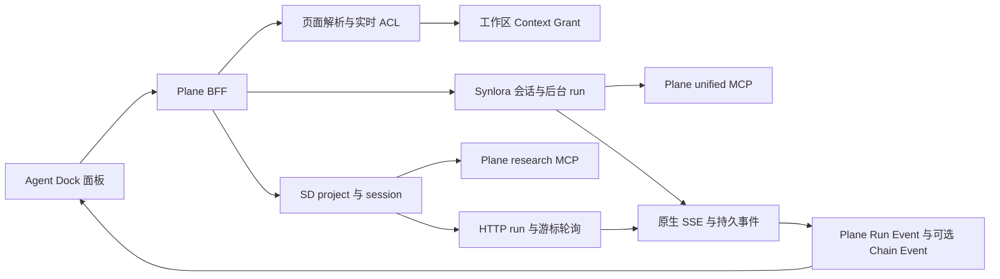

# Plane Agent Dock 多后端架构

Agent Dock 通过同一组 `/api/workspaces/<slug>/agent-dock/*` BFF 接口接入 Synlora 与 ScienceDiscovery（SD）。面板显式选择「云端（Synlora）」或「本地（ScienceDiscovery）」，不根据连通性自动切换后端。

## 链路与职责

| 层     | 共同职责                                               | Synlora                      | ScienceDiscovery                         |
| ------ | ------------------------------------------------------ | ---------------------------- | ---------------------------------------- |
| Plane  | 用户身份、工作区治理、实时 ACL、页面上下文、授权、审计 | unified MCP 连接与服务端凭据 | research MCP 独立 connector 与服务端凭据 |
| 上游   | 执行 run、维护工具及审批、提供持久事件                 | v1 session、token、原生 SSE  | project/session、HTTP run、HTTP 事件轮询 |
| 浏览器 | 输入、回放、工具证据和审批展示                         | cloud 线程槽                 | local 线程槽                             |

浏览器不持久化 token、后端凭证、上下文正文或文件内容。线程槽按用户、工作区和 provider 分开；云端沿用原 storage key。切换 provider 只切换浏览器订阅，不取消另一个 provider 的后台运行。

## 上下文与授权

`POST /context/resolve/` 接收可选 `provider`，默认 `SYNLORA`。服务端复用相同页面解析、focus、workspace scope 和 ACL，返回 `agent-context-envelope.v2`。Envelope 包含 `provider` 及 `science_discovery.available/reason`，用于禁用未配置的本地选项并引导到个人智能体后端设置。

| 内容           | 约束                                                                                   |
| -------------- | -------------------------------------------------------------------------------------- |
| 会话 target    | 工作区稳定；每轮页面变化只更新 focus                                                   |
| 页面快照       | route、焦点、摘要、选中文本、context hash；服务端重新校验可见性                        |
| Synlora 工具面 | Plane unified MCP，继续执行既有工具策略                                                |
| SD 工具面      | `mcp_catalog.TOOL_NAMES` 的科研只读工具；关闭 `RESEARCH_MCP_ENABLED` 时为空            |
| SD grant       | 使用独立 policy version，与 Synlora grant 不可互换                                     |
| 资源读取       | workspace grant 可读取实时可见科研项目；旧 node/project grant 仍受原项目和节点范围限制 |

SD 上游没有 per-run context 参数。上下文通过 Dock 专属 specialist、独立 research MCP connector 和每轮消息 JSON 前缀共同注入。前缀限制为 16000 字符，保留完整 JSON，移除 route query/fragment 并屏蔽常见凭据；页面文字属于不可信参考数据。

## 会话装配与刷新

`POST /sessions/` 接收 `provider` 与已解析的 `context_id`。SD 必须同时满足用户自配连接和工作区 `research_agent_user_backend_enabled` 治理开关，否则返回 409 `science_discovery_not_configured`。

SD 会话装配锁定用户连接，复用当前用户在工作区的 Dock 会话；首次创建时按名称复用或创建 `Plane Dock · <workspace> [<workspace UUID>:<user UUID>]` project。可读名称可裁剪，稳定身份部分完整保留，避免不同用户或同名工作区复用同一 project。已有会话始终使用持久化的远端 ID。装配时同步 `Plane Dock 工作区助手` specialist，并明确绑定当前 grant 的 connector。关闭 MCP 时 connector 列表显式为空。数据库沿用 `provider`、`sd_project_id`、`sd_session_id` 和 `backend_connection`，无需新增迁移。

上下文过期后，刷新保留远端 session 和事件游标，轮换 grant 与 connector。更新 SD settings 前合并既有 overrides，保留用户模型等设置。成功后撤销旧授权并清理旧 connector；失败时撤销新授权并清理新 connector，撤销写入在事务回滚后持久化。同一 grant 的刷新幂等，运行期间拒绝轮换。

## 消息与运行生命周期

1. 每轮消息实时构造页面上下文，在事务中先生成并持久化独立 Plane `run_id`、`INITIALIZING` 状态和 `assembly.sd_submission` 提交意图，再提交上游运行。
2. 同一事务写入 `COMMUNICATION`、`USER_MESSAGE` 和含 `page_context_hash` 的 `CONTEXT_ASSEMBLED` 事件；消息前缀携带稳定 `request_id`，提交意图保存完整 prompt 哈希。
3. JSON `/runs/<id>/events/` 按本地 `seq` 回放；SSE `/runs/<id>/events/stream/` 输出统一 `agent-dock-event.v1`。两者游标不可混用。
4. Synlora 继续代理原生 SSE。SD 每次轮询使用持久化 `source_cursor`，按 `(session, run_id, remote_seq)` 幂等投影，并拒绝上一轮迟到响应。
5. SD SSE 包装 HTTP 轮询，发送 `context.bound`、心跳、输出、工具、审批和终态；连接最长约 25 秒，浏览器以 `Last-Event-ID` 或 `after_seq` 续传远端游标。数据库按当前 run 和 `payload.remote_seq > cursor` 读取增量事件，事件投影前屏蔽凭据字段。
6. `run.completed`、`run.failed`、`run.cancelled` 收敛本地状态，终态后不接受迟到审批重新激活运行。Celery reconciliation 在浏览器离线期间继续补拉两种 Dock 后端。

SD 的 `assistant.delta` 追加文本，`assistant.snapshot` 替换当前文本；历史回放合并为完整回答。SD JSON 回放与 SSE 共用归一化函数。`tool.output` 即使没有 trace，也保留 `toolCallId` 与 `chunk`，不会覆盖已有工具名和参数。工具按 `(run_id, tool_call_id)` 关联，避免跨轮复用工具 ID 时混合结果。

### 提交恢复与补偿

`sd_submission.phase` 使用 `pending`、`bound`、`rejected`、`cancel_pending`、`cancelled` 描述提交与补偿状态。远端返回后绑定原有 Plane run ID，不生成第二个本地 run。同一 `request_id` 和相同消息幂等返回；不同消息复用该标识返回 409。

网络超时、HTTP 408、上游 5xx 或缺少 run ID 都不能证明提交失败。BFF 和后台任务通过 SD 现有 `GET /api/sessions/<id>/runs`，校验 prompt 前缀的 `request_id` 和完整 prompt 哈希；仅唯一匹配时恢复绑定。零匹配或多个匹配继续保留待确认状态，拒绝新消息，绝不自动重发 POST。上游明确的其他 4xx 记为拒绝，保留兼容 BFF HTTP 状态。SD 无需增加幂等接口。

远端成功而本地绑定失败时立即补偿取消；取消失败保存远端 ID 和 `cancel_pending`，供后台重试。显式 cancel 先收敛本地状态，再执行远端取消；待确认提交也保存取消意图，恢复到远端 ID 后补偿取消。迟到的恢复响应不得重新激活已终止 run。

Reconciliation 同时覆盖活跃运行和未确认提交、待补偿取消；后两者超过 24 小时仍继续恢复。批次按最近处理时间轮转，失败只记录会话、run、稳定错误码或异常类型，准确计入 `failed`，不输出消息和凭据。

### 审批身份

`permission_request_id` 标识审批卡片，`tool_call_id` 标识实际工具调用，两者不可互换。当前卡片与执行历史复用摘要、动作和资源展示，历史中另行标识审批处理事件。前端提交 `{approved, permission_request_id}`，后端根据当前 run 的持久事件计算待审批集合，验证目标仍待处理，再映射为 SD 的 `allow_once` 或 `deny`。兼容旧布尔请求时，仅在唯一待审批请求下推断目标；多条待审批或重复回答返回 409。解决一条后，只要仍有其他请求，会话继续保持 `WAITING_APPROVAL`。

## 正式报告与反馈

只有 `target_type=WORKSPACE` 且 policy 为 `agent-dock-science-discovery.v1` 的 SD Dock grant 使用实时报告范围。报告必须明确关联当前用户可见的科研节点，同时满足报告本身的实时 ACL。仅工作区可见或同项目并不足以获得读取权限。

列表返回当前最新正式版本；读取必须显式提供 `version`，不读取草稿。正式版本更新后，旧版本读取返回 `report_context_version_changed`，调用方必须重新列出并选择。节点失去可见性、关联失效或报告 ACL 撤销后立即拒绝读取。显式人工反馈复用同一节点关联、ACL 和当前正式版本范围，普通讨论不进入反馈结果。

旧节点 grant 继续使用创建时的 `allowed_reports` 固定版本白名单，其他连接授权规则保持原语义。

## 历史与兼容边界

历史会话统一序列化 `provider`，面板显示文字标识并支持跨 provider 恢复。`GET /sessions/<id>/events/` 从本地事件表分页读取整个会话，保留各事件原始 run ID；默认每页 200 条，最多 500 条。签名游标绑定会话及首屏事件上界，一小时内有效，避免分页期间新写入改变历史范围。

前端按 `(run_id, source_seq)` 去重，无远端序号的本地事件以本地 seq 区分；旧轮终态只进入历史，不修改当前运行状态。当前 run 的 SSE 游标单独维护；Synlora 重建历史显示后从该轮起点续传，以补齐未持久化的瞬时增量。取消、审批、列表、分页历史和待导航历史均校验用户、工作区、provider 及请求代次，迟到响应不能覆盖新作用域。

历史读取与远端执行分开判断：连接关闭或云端不可用时，仍可列出并恢复本地历史；发送、取消和审批操作禁用。SD 已知健康状态为 `DOWN` 时不可执行，重新保存配置或连接测试成功后恢复可用；未知健康状态沿用原有配置判断。个人后端设置保存、删除、测试完成（含失败）后使对应工作区的 availability 失效；面板重新打开和窗口聚焦也重验。Synlora 状态缓存也绑定当前用户并响应配置失效通知。运行中的重验只改变可用性，不重置运行阶段或轮换 grant。关闭面板仅断开订阅。

SD 历史只包含 Dock workspace 会话，旧科研节点 SD 会话不迁移。

科研节点工作台继续使用旧 `/api/research/.../agent/*` API 和独立运行生命周期。SD artifact 本次仅以事件展示，内容代理继续沿用原端点；不新增产物归档、共享 SD 连接或模型 key 管理。

## 回归基线

2026-11-05 已用 HEAD 原投影函数独立复现以下两条旧测试失败，本次不修改旧节点 API 的断言或事件键格式：

- `test_science_discovery_projection_is_idempotent`
- `test_science_discovery_cancelled_maps_degraded_agent_and_human_decision_chain`

两者期望 `chain:sd:*`，现有原实现写入 `chain:run:*`。本次新增 SD Dock 的恢复、审批、完整历史及报告 ACL 测试单独验证；版本沿用未发布的 `9.17.0`。
