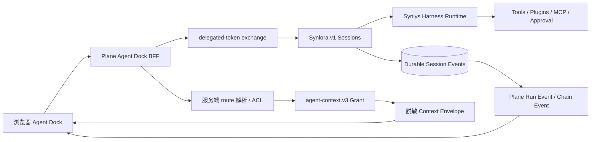

# Plane × Synlora Agent Dock 架构

## 目标链路

## 职责边界

- **Plane**：用户身份、Workspace/Project/Research ACL、Context Token、会话 target 绑定、本地事件投影、审批入口、产物确认与审计。
- **Synlora**：Agent Runtime、系统提示词装配、工具/插件/MCP 防御性交集、后台 run、事件事实源、Human-in-the-loop、产物生成。
- **浏览器**：仅展示与交互；不保存 token、凭证、上下文正文或文件内容。

## 上下文分层

| 层             | 内容                             | 展示                       |
| -------------- | -------------------------------- | -------------------------- |
| Workspace      | 工作区名称与当前 route           | Envelope hierarchy         |
| Project        | 项目、科研状态、负责人引用       | Envelope hierarchy         |
| Research Chain | 链、阶段、节点计数、共享资源引用 | Envelope resources         |
| Node           | 节点、任务、材料、上传、事件引用 | Envelope + on-demand tools |
| Capability     | tools/plugins/MCP/KB/file 硬上界 | Context/Runtime 视图       |
| Turn           | context version、manifest hash   | `CONTEXT_ASSEMBLED` 事件   |

## 生命周期

1. Dock 打开或 route 变化：Plane 服务端 resolve context。
2. 创建/恢复 target-bound session：Synlora session metadata 绑定 v3 Context。
3. 每轮消息：Plane 解密服务端 token，Synlora 回调 Plane 复验后启动后台 run。
4. Plane 按 `(session_id, remote_seq)` 幂等拉取 durable events。
5. 工具审批走 Synlora answer；正式产物保存仍由用户确认并写 Plane 审计。
6. 关闭 Dock 只断开前端订阅；显式停止才 cancel。

## 兼容性

- `agent-context.v2` 继续可用，并映射为 `RESEARCH_CHAIN_NODE`。
- Plane 旧 `/assistant/*` 与科研链旧 Agent API 保留兼容期。
- ScienceDiscovery 仍作为科研节点可选 Provider，不参与全局/链级默认会话。
