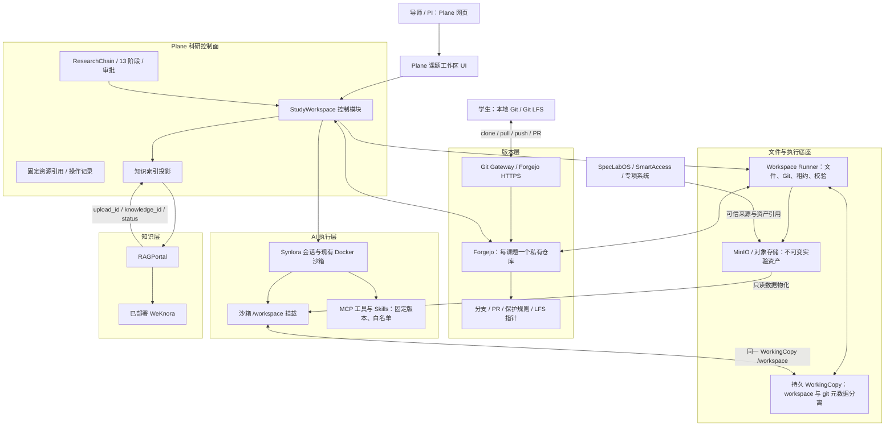

# AI-Native Research Workspace 目标架构

| 项目     | 内容                                                                                                                          |
| -------- | ----------------------------------------------------------------------------------------------------------------------------- |
| 文档版本 | v1.0                                                                                                                          |
| 日期     | 2026-11-07                                                                                                                    |
| 状态     | 规划中；本文只定义目标架构与边界，不代表功能已实现或已部署                                                                    |
| 配套计划 | [`AI-Native Research Workspace 分阶段开发计划`](../plans/research-workspace/ai-native-research-workspace-development-plan.md) |
| 读者     | Plane / Synlora / RAGPortal 研发、平台运维、产品负责人                                                                        |

## 1. 结论

AI-Native Research Workspace 将 Plane 研究链的“课题资料（全流程共用）”升级为一个可版本化、可审计、可供 Agent 直接使用的科研工作区。

最终采用以下架构决策：

1. **一条研究链对应一个 StudyWorkspace，并对应一个 Forgejo 私有 Git 仓库。**
2. **Plane 继续作为科研流程、组织权限和正式审批的控制面。**
3. **Forgejo 作为独立 Git 服务，通过 API、Webhook 和 HTTPS Git 协议集成，不修改其源码。**
4. **首期不新建独立 RWS 微服务；在 Plane 内新增研究领域模块，Workspace Runner 作为独立进程部署。**
5. **Synlora 继续作为主 Agent 执行层，复用现有 Docker 沙箱，不引入 OpenHands 替代它。**
6. **RAGPortal / WeKnora 只接收固定版本的索引任务，是派生知识投影，不成为文件权威源。**
7. **“同一存储”指 Plane 与 Synlora 使用同一个服务端注册的 WorkingCopy，不表示所有人同时写一个 checkout。**
8. **文本、Git LFS 对象和实验数据分别治理；审批与复现实验只接受固定 hash，不接受 `main` 或 `latest`。**

本方案整合 Astra 与 Claude 两版计划的取舍：

| 维度     | Astra 方案                   | Claude 方案                  | 最终取舍                                    |
| -------- | ---------------------------- | ---------------------------- | ------------------------------------------- |
| 服务形态 | Plane 内控制面 + 独立 Runner | 独立 RWS 服务                | 首期采用 Astra，降低身份与部署复杂度        |
| 产品蓝图 | 安全、迁移和验收边界更稳     | API、UI、CLI、IDE 蓝图更完整 | 以 Astra 为底线，吸收 Claude 的产品接口设计 |
| Git 引擎 | Forgejo                      | Forgejo                      | 一致，选 Forgejo                            |
| Agent    | 租约、隔离 `.git`、运行回执  | checkpoint 和 PR 体验        | 两者合并：安全运行 + 候选 PR                |
| 知识索引 | 用户选择固定版本推送         | push 后自动索引              | 首期手动 / 策略化推送，避免误索引草稿       |
| 迁移     | 双读单写、逐课题试点         | 迁移脚本和用户旅程更完整     | 以 Astra 安全边界为准，吸收 Claude 脚本设计 |

## 2. 概念模型

| 概念             | 含义                                                     | 生命周期         |
| ---------------- | -------------------------------------------------------- | ---------------- |
| Plane Workspace  | 现有组织空间，承载账号、组织、项目、任务和审批           | 长期             |
| StudyWorkspace   | 一条 ResearchChain 对应的课题资源边界，绑定一个 Git 仓库 | 课题全过程       |
| WorkingCopy      | 某个用户、云端编辑会话或 Agent 运行对应的持久工作副本    | 可长期保留       |
| Runtime          | Synlora 沙箱、JupyterLab、code-server 等计算环境         | 可销毁重建       |
| Asset Revision   | 原始实验数据或大结果的不可变版本                         | 长期审计与复现   |
| Index Projection | 固定源版本推送 RAGPortal 后的回执映射                    | 派生数据，可重建 |

关键区别：

- StudyWorkspace 不是新的 Plane 组织 Workspace。
- Runtime 停止或删除不等于删除 WorkingCopy。
- Git PR 合并不是科研阶段审批。
- WeKnora 索引成功不是源文件保存的前置条件。

## 3. 模块架构



### 3.1 Plane 控制面

Plane 负责：

- ResearchChain、13 阶段、节点、任务和正式审批。
- StudyWorkspace 生命周期、资源引用、操作记录和索引投影。
- 课题角色到 Git 仓库权限的映射。
- 工作台 UI、阶段材料固定引用和事件回流。

Plane 不直接执行：

- Git Smart HTTP 协议。
- 任意 shell 命令。
- Docker 沙箱生命周期。
- 全部课题目录的直接读写。

### 3.2 Workspace Runner

Runner 是独立可信进程，负责：

- 根据服务端注册的 `mount_ref` 解析实际目录。
- 创建、检出和回收 WorkingCopy。
- 执行受控 Git 操作、文件原子替换和完整性校验。
- 维护写租约、fencing epoch 和长任务心跳。
- 将固定资产只读物化到 Agent 运行环境。

首期部署约束：

- Runner、Synlora 和持久卷在同一可信宿主。
- WorkingCopy 使用验证过 POSIX 语义的持久卷。
- Agent 只挂载 `copies/<copy-id>/workspace`。
- Git 元数据由 Runner 管理在独立目录，例如 `copies/<copy-id>/git`。
- 浏览器和 Synlora 均不能提交任意宿主路径。

### 3.3 Forgejo

Forgejo 负责：

- Git 对象、分支、PR、Review、分支保护和 LFS 指针。
- 原生 HTTPS clone / fetch / push。
- Webhook 推送仓库事件。

不负责：

- 科研阶段审批。
- 组织成员最终权限。
- WorkingCopy 租约。
- 实验资产版本。

首期只开放 HTTPS Git 访问；SSH 直连暂不开放。Forgejo 的 issue、wiki、projects 等无关单元在部署中关闭。

### 3.4 Synlora

Synlora 负责：

- Agent 会话、模型调用、现有 harness 和 Docker 沙箱。
- 接收 Plane 签发的研究工作区绑定。
- 在指定 WorkingCopy 中执行任务。
- 保存运行上下文、日志摘要和输出清单。

Synlora 不负责：

- 解析任意宿主路径。
- 持有组织级 Git 凭据。
- 直接写 `main`。
- 在共享绑定失效时回落到个人目录。

### 3.5 RAGPortal / WeKnora

RAGPortal 继续使用现有上传与状态接口。Plane 保存固定源版本与外部回执的映射；首期不要求 RAGPortal 或 WeKnora 增加 commit 字段。

本方案不设计 WeKnora 内部向量化、检索或知识图谱实现。

## 4. 权威数据源

| 数据                       | 权威源                   | 说明                         |
| -------------------------- | ------------------------ | ---------------------------- |
| 课题、阶段、任务、正式审批 | Plane                    | Git PR 合并不推进科研阶段    |
| Git 提交、分支、PR、标签   | Forgejo                  | Plane 只保存映射和对账结果   |
| 云端未提交草稿             | 当前 WorkingCopy         | 必须纳入备份，不能只备份 Git |
| 原始实验数据、大结果       | Asset Store              | Git 只保存 manifest 和 hash  |
| Agent 会话与日志           | Synlora / Plane 运行回执 | Agent 不能改写权威审计       |
| 向量库 / 知识图谱          | RAGPortal / WeKnora      | 派生投影，可重建             |

跨系统操作不假设分布式事务。统一流程为：

```text
持久化操作意图
  → 调外部系统
  → 保存外部 ID / 结果
  → 发事件或更新投影
  → 失败进入可重试或待对账状态
```

## 5. 存储布局与数据分级

推荐课题仓库模板：

```text
README.md
AGENTS.md
.research/
  workspace.yaml
  index-policy.yaml
  agents.yaml
  assets/*.json
  skills.lock.json
  mcp.bindings.json
literature/
research/
protocols/
src/
notebooks/
results/
data/
outputs/agents/<run-id>/
envs/
skills/
tmp/
```

`.research/` 中不得保存 token、密码、长期下载地址或其他秘密。

数据分级：

| 类型                               | 存储       | 固定方式                       |
| ---------------------------------- | ---------- | ------------------------------ |
| Markdown、脚本、小型参数表         | Git        | commit + path + blob OID       |
| PDF、Office、图像等中等二进制      | Git LFS    | commit + LFS OID + size        |
| 原始谱图、影像、大实验数据、大结果 | 对象资产层 | asset revision + sha256 + size |

初始产品阈值：

- 普通 Git 单文件：10 MiB。
- Git LFS 单文件：200 MiB。
- 超过 200 MiB 或属于原始实验数据：不可变资产 + manifest。

阈值可按课题组策略调整，但正式审批和可复现实验始终使用内容 hash。

## 6. 协作与并发规则

### 6.1 分支规则

| 类型         | 模式                      | 说明                           |
| ------------ | ------------------------- | ------------------------------ |
| 主干         | `main`                    | 受保护，只能 PR 合并           |
| 用户分支     | `user/<subject>/<task>`   | 学生、导师或其他成员的个人工作 |
| Agent 分支   | `agent/<run-id>`          | 一次可追溯运行                 |
| 阶段封存标签 | `stage/<STAGE_CODE>/v<N>` | 审批通过后由服务受控创建       |

分支是协作边界，不是保密边界。仓库读权限决定可见对象和历史；敏感合作应拆仓或使用独立资产授权，不能依赖私有分支。

### 6.2 WorkingCopy 写入规则

- 同一 WorkingCopy 同时只有一个活动写者。
- 用户编辑与 Agent 交接写权限；其他视图只读。
- 并行用户或 Agent 创建独立 WorkingCopy 和分支。
- 写租约不能只是数据库 TTL；过期或撤权时必须停止相关运行、撤去写挂载并拒绝新写入。
- 文件写入使用临时文件加原子替换，并携带 expected ETag。
- Git commit 只提交显式选择的路径，不自动提交全部目录。

### 6.3 本地与云端同步

- 本地是独立 clone，通过 Git push / pull 交换已提交状态。
- 本地离线未推送修改只在本地存在，界面如实显示“仅本地 / 待推送”。
- 云端 WorkingCopy 只在可 fast-forward 时同步；冲突保留双方并提示处理。
- 不自动 force reset，不做完全实时协同编辑。

## 7. 身份与权限

### 7.1 身份来源

- AI4MS / Plane 继续作为用户身份来源。
- Plane 研究链角色继续作为科研授权来源。
- Forgejo 用户和团队是 Plane 同步的投影。
- 不新建科研账号体系。

### 7.2 角色映射

| Plane 角色     | Git / Workspace 能力                                 |
| -------------- | ---------------------------------------------------- |
| 课题读取者     | 读取仓库历史、资产和索引状态                         |
| 课题写入者     | 创建个人分支、提交、发起 PR、运行获授权 Agent        |
| 导师 / PI      | Review、合并、参与正式阶段审批                       |
| Agent 服务身份 | 只写指定 Agent 分支和显式授权路径                    |
| 平台管理员     | 管理存储、服务连接、配额和备份，不自动获得正文审批权 |

### 7.3 Git 访问令牌

- 用户可创建可撤销的 `rwspat_` 个人访问令牌。
- 服务端只保存令牌 hash。
- scope 覆盖 Git、API 和 Data 权限。
- 撤权必须同时影响网页、API、MCP、预签名 URL、Git 访问和运行租约。

P0 必须验证 Forgejo reverse proxy auth 是否覆盖 Git HTTP 与 LFS。不可用时，Gateway 使用服务端保管的 per-user shadow token 替换转发，不暴露 Forgejo 管理员 token。

## 8. 固定资源引用

对外展示 URI：

```text
rws://<study_id>/<path>@<full_commit_sha>
```

机器契约：

```json
{
  "schema": "research-resource-ref.v1",
  "study_id": "<uuid>",
  "kind": "git",
  "repository_id": "<registered_repo_id>",
  "commit": "<full_commit_sha>",
  "path": "research/opening/report.md",
  "blob_oid": "<git_object_oid>",
  "content_sha256": "<sha256>",
  "size": 12345
}
```

资产引用使用 `kind=asset`，必须包含：

- `asset_revision_id`
- `sha256`
- `size`
- 可选 `source_run_id` 和来源系统引用

`branch`、`main`、`latest` 只能用于浏览，不能用于正式审批、阶段封存或可复现实验。

## 9. 数据模型增量

| 实体                       | 关键字段                                                                                               | 责任                    |
| -------------------------- | ------------------------------------------------------------------------------------------------------ | ----------------------- |
| `StudyWorkspace`           | `chain_id`、`code_repository_id`、`storage_namespace`、`default_branch`、`status`                      | 每条 ResearchChain 唯一 |
| `WorkspaceWorkingCopy`     | `study_id`、`owner_subject`、`branch`、`base_commit`、`runner_id`、`mount_ref`、`state`、`lease_epoch` | 分支与持久目录绑定      |
| `ResearchAssetRevision`    | `study_id`、`logical_asset_id`、`version`、`sha256`、`size`、`source_run_id`、`state`                  | 不可变大数据版本        |
| `WorkspaceOperation`       | `kind`、`idempotency_key`、`payload_hash`、`expected_head`、`state`、`actor`、`result/error`           | 跨系统操作意图与对账    |
| `WorkspaceIndexProjection` | `source_ref_digest`、`kb_id`、`upload_id`、`knowledge_id`、`generation`、`status`                      | 源版本与知识库回执映射  |
| 阶段材料引用               | 在现有 MaterialItem 上新增 `resource_ref`，保留旧 `upload_id`                                          | 新旧材料证据并存        |

状态：

```text
StudyWorkspace:
  PROVISIONING / READY / READ_ONLY / ARCHIVED / ERROR

WorkingCopy:
  CREATING / READY / WRITING / STOPPED / CONFLICT / ERROR

WorkspaceOperation:
  PENDING / RUNNING / SUCCEEDED / FAILED / RETRYING / NEEDS_RECONCILE

WorkspaceIndexProjection:
  NOT_PUSHED / QUEUED / PROCESSING / READY / FAILED /
  SOURCE_UPDATED / WITHDRAW_PENDING / RECONCILING
```

## 10. 核心 API 方向

基础路径：

```text
/api/research/workspaces/{workspaceSlug}/chains/{chainId}/workspace
```

| 能力       | 接口                                                    |
| ---------- | ------------------------------------------------------- | ------------------- | --------- | ----- |
| 幂等创建   | `POST /ensure`                                          |
| 状态总览   | `GET /`                                                 |
| 工作副本   | `POST /copies`                                          |
| 文件树     | `GET /tree`                                             |
| 文件内容   | `GET                                                    | PUT /files/content` |
| 上传       | `POST /files/uploads`                                   |
| Git 状态   | `GET /git/status`                                       |
| Git 操作   | `POST /git/commit                                       | fetch               | integrate | push` |
| PR         | `POST /pull-requests`                                   |
| 资产       | `POST /assets/uploads`、`POST /assets/complete`         |
| Agent 绑定 | `POST /agent-bindings`                                  |
| 知识投影   | `POST /index-projections`                               |
| 操作状态   | `GET /operations/{id}`                                  |
| 迁移导出   | `POST /import-preview`、`POST /imports`、`POST /export` |

所有写入接口必须携带 `Idempotency-Key`。涉及 Git HEAD 的操作必须携带 `expected_head`；冲突返回 `409` 或 `412`。

## 11. Synlora 绑定契约

```json
{
  "schema": "research-workspace-binding.v1",
  "plane_workspace_id": "<uuid>",
  "study_id": "<uuid>",
  "chain_id": "<uuid>",
  "working_copy_id": "<uuid>",
  "branch": "agent/<run-id>",
  "base_commit": "<full_sha>",
  "asset_manifest_digest": "<sha256>",
  "grant_id": "<opaque_reference>",
  "capabilities": ["files.read", "files.write", "run.execute", "changes.propose"],
  "policy_version": 1
}
```

规则：

- 绑定对象不包含 host path、Git secret、S3 secret 或原始 MCP token。
- 绑定不是授权本身；Synlora 必须用短期凭据向 Plane / Runner 校验。
- 绑定失效时直接失败，不回落个人目录。
- 运行前固定 input commit、资产清单摘要、Skills digest、MCP 能力快照和环境镜像 digest。
- 运行后保存 run receipt、输出摘要、改动清单和候选提交。
- 删除会话不删除共享课题 WorkingCopy。

## 12. 阶段审批与证据闭环

阶段材料提交时冻结完整 `research-resource-ref.v1`。Plane 阶段审批仍是唯一正式审批。

审批通过后：

1. 对被审批 commit 创建受保护 `stage/<STAGE_CODE>/v<N>` 标签。
2. 写入 ResearchChainSnapshot。
3. 保留旧审批快照，不追认新文件。
4. 后续输入变化只标记相关评估“输入已更新”，不篡改历史审批。

v1 审批后出现 v2 修改时，v1 的文件、图表和数据仍必须可精确恢复。

## 13. 知识索引边界

固定版本索引流程：

```text
用户选择 commit/path 或 asset revision
  → Plane 校验权限、hash 和内容可读性
  → 创建幂等索引任务
  → 调用 RAGPortal POST /api/uploads
  → 保存 upload_id / knowledge_id / 状态 / 错误
  → 超时、409、乱序回执进入对账
```

规则：

- 默认不索引私人草稿、Agent 中间输出、任意代码产物和大数据本体。
- 索引失败不回滚源文件或 Git commit。
- 旧版本回执不能覆盖新版本状态。
- 409 只有确认同 hash 且可访问 knowledge_id 后才能视为复用成功。
- 后续可对“已合并 main 且允许发布”的资料配置自动索引策略。

## 14. UI 信息架构

Plane 将“课题资料”升级为“课题工作区”，但不推翻研究链信息架构：

| 区域 | 内容                                                          |
| ---- | ------------------------------------------------------------- |
| 顶部 | 课题名、当前分支、基线 commit、未提交变化、远端差异、运行状态 |
| 左侧 | 全课题文件树；阶段切换只做筛选和引用视图                      |
| 中间 | 预览、编辑、数据集、diff、PR、运行结果                        |
| 右侧 | Synlora 上下文、分支、输入版本、Skills / MCP 能力和候选改动   |

用户动作语义：

| 按钮          | 实际行为                      |
| ------------- | ----------------------------- |
| 保存草稿      | 写当前 WorkingCopy，不 commit |
| 保存版本      | 校验选定文件并创建 Git commit |
| 推送          | 同步远端分支                  |
| 获取更新      | fetch 并展示差异，不覆盖草稿  |
| 提请合并      | 创建 Git PR                   |
| 提交阶段材料  | 固定资源引用并走 Plane 审批   |
| 请 Agent 分析 | 创建运行分支和可追溯 run      |
| 关联知识库    | 推送固定版本到 RAGPortal      |

UI 必须遵循 `academic-editorial-ui`：安静、克制、学术编辑感；层级来自排版、留白、对齐和分隔线，不使用渐变、发光、彩色卡片或 AI 仪表盘装饰。

## 15. 不在首期范围

- 新建独立 RWS Web 服务。
- 引入 OneDev、GitLab 或 OpenHands 并行试点。
- 重写 Synlora harness。
- Coder 多机、GPU 和环境模板调度。
- WeKnora 向量化、检索和知识图谱内部设计。
- 全部课题批量迁移。
- 完全实时协同编辑。
- 自动合并冲突。
- 把 Git 当数据库。
- 自动执行仓库中的 SKILL.md 或 AGENTS.md 脚本。
- 本地 / 云端双活 Git 集群。
