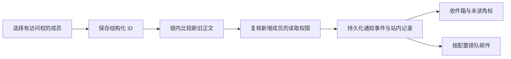

# 成员提及与站内通知 9.18.0

## 问题与范围

2026 年 11 月 6 日，生产科研任务评论已保存合法成员 ID，但评论通知只向订阅者生成。无订阅者时，直接提及没有事件和站内通知。普通文档原先只记录提及日志，也缺少站内通知生成。

本次从生产 `9.17.0` 的 `c28e793e9e017480f28b793decf702a0917e4a0a` 建立独立工作树，发布兼容能力版本 `9.18.0`。不扫描或补发历史内容，不增加弹出提醒，不扩展个人便签和未提交输入。

## 提及机制

编辑器保存 `<mention-component entity_name="user_mention" entity_identifier="用户 UUID">`。节点负责成员身份与显示，业务保存链路负责通知，两者不是同一个动作。普通文本 `@姓名`、邮箱、文档引用、项目引用不会触发成员通知。



- 创建通知所有有效提及；编辑只通知新增成员。同一正文中的重复节点只算一次。
- 删除提及并成功保存后，再次加入会产生新通知；不同评论再次提及也会产生新通知。
- 本人提及本人不产生通知；被提及者无需订阅。科研任务同次修改中，提及优先于指派、普通订阅通知。
- 候选与保存均使用源资源权限。新增无权、停用、跨工作区成员会返回 `400` 并回滚保存。损坏 UUID 节点逐个忽略，不影响其他合法节点。
- 管理员无法关闭 `mention`、`research_mention` 的站内通知，历史关闭配置的有效值同样为开启。邮件仍遵循工作区策略和个人偏好。

## 实现入口

| 来源                 | 保存与差分                                                   | 通知持久化                                                   |
| -------------------- | ------------------------------------------------------------ | ------------------------------------------------------------ |
| 行政工作项描述、评论 | Web、API、MCP 共用序列化器；锁内旧正文用于权限校验和生成快照 | 沿用同事务 `NotificationGenerationOutbox`；提交后唤醒 worker |
| 科研任务说明、评论   | 说明和评论各自按锁内旧正文差分                               | 业务事务内写事件、站内记录、邮件投递记录                     |
| 周期报告批注、回复   | 创建直接解析；编辑锁定评论并差分                             | 评论保存事务内写通知，附线程和评论 ID                        |
| 普通文档             | 普通保存与协同正文保存均锁定 Page                            | Page 保存事务内写通知                                        |
| 报告、阶段材料正文   | 草稿不投递；提交时比较前一正式快照                           | 正式快照事务内写通知                                         |

公共解析、接收人和候选权限在 `plane/utils/mentions.py`；普通文档和正式正文入口在 `plane/utils/mention_notifications.py`。候选接口增加可选 `source_type`、`source_id`，新建时使用项目等父级上下文，保留 `user_mention` 响应格式。

事件幂等键包含来源、接收人、类别和持久化修订标识：行政使用活动 ID；科研评论和任务说明使用保存时间及来源 ID；文档使用 Page 修订时间；正式正文使用快照 ID。行锁确保并发保存以实际旧正文差分。

## 读取与跳转

复用收件箱、`@我的` 分类及现有 45 秒轮询。新增记录在下一轮刷新后反映到角标。

- 通知记录携带服务端生成的站内路由，行政评论使用评论锚点，科研任务和报告使用评论查询参数。
- 同页连续打开另一条通知时重新定位目标评论；报告会展开讨论并切到全部讨论。
- 文档跳转到文档正文；阶段材料跳转到材料详情并显示按权限返回的正式正文。
- 读取列表、计数及修改已读、归档状态均依赖当前可读取集合。来源或定位评论删除、权限撤销后排除通知；邮件发送前再次检查权限。

## 验证记录

隔离 PostgreSQL 测试库运行，未启动项目禁止的测试 Compose 栈。

- 后端相关 160 项通过，覆盖差分、重复节点、移除再提及、请求重试、并发 Page 保存、事务回滚、无订阅者直接提及、权限撤销、正式正文差分、固定站内策略和邮件偏好。
- 普通文档、阶段材料通过真实事件与邮件投递记录的队列领取及本地邮件发送验证，没有连接外部 SMTP。
- 前端 7 个文件共 76 项通过，覆盖收件箱、计数、策略设置、任务评论、报告评论与正文；增加同页连续通知定位测试。
- Web 类型检查、Web/Admin 及其依赖的 12 个构建任务通过。修改的 Python 文件 Ruff 检查通过，`issue_mutations.py` 原有导入行超长除外；`git diff --check` 通过。
- 浏览器使用真实组件与编辑器，在服务边界模拟业务 API。桌面 `1440x1000`、移动端 `390x844` 检查任务提及、报告评论定位与固定开启设置，无横向溢出。此项不是生产双账号浏览器端到端测试。

扩大核查时遇到的既有失败已在未修改的生产基线复现：邮件过滤器对逗号分隔邮箱的拒绝假设，以及旧阶段测试对博士课题自动创建阶段的假设。本次未修改这些业务行为。

## 发布与回滚

1. 发布前确认生产工作树干净，仍为上述基线；备份旧 Git 引用与 Web/Admin 构建目录。
2. 推送已验证的独立分支，将生产 main 快进到发布提交。版本信息同步到 `9.18.0`。
3. 使用 `./scripts/deploy.sh --skip-pull`，不重跑 setup、不覆盖 `.env`。
4. 核对 API、普通 worker、beat、通知生成 worker、邮件 worker、Caddy 健康，以及后端和前端版本。
5. 针对原任务在显式回滚事务内创建新的验收评论，确认无订阅者时仍产生一条提及事件、通知和可读取路由，最后回滚。旧评论不补发，验收记录不提交，邮件不对外投递。
6. 回滚时检出备份 Git 引用，恢复备份的 Web/Admin 构建目录，再重建 API、worker、beat、通知生成 worker、邮件 worker 和 Caddy。本次没有新增数据库迁移。

部署实际结果在生产验收记录中保留，只有健康检查和事务回滚验收完成后才算发布完成。

生产已保留旧代码引用 `rollback/9.17.0-before-mentions-20261106`，备份目录为 `/home/fangyikai/plane-release-backups/mentions-20261106-1425`，包括旧源码和 Web/Admin 构建产物。

## 生产验收结果

2026 年 11 月 6 日 14:42（北京时间）完成发布验收。应用发布提交为 `26267cb1748b35c42ed8fd2b646c14cbb935cb9c`，生产 `main` 已快进到该提交。

- API、普通 worker、beat、通知生成 worker、邮件 worker 的运行容器均读取到 `9.18.0`；实例接口返回 `instance.current_version = 9.18.0`。
- 实际 HTTP 请求的 Web 资源 `assets/package-BgJGMqqm.js` 包含 `9.18.0`。Web、Admin、实例 API 均返回 `200`，文档转换服务为 `healthy`，相关容器均为 `running`。
- 通知生成 worker 和邮件 worker 正常领取任务。验收仅检查提及的持久化邮件投递记录，没有实际发送验收邮件。
- 原故障任务 `fbf7cc63-3d3c-4557-aafe-d71dbe175fcd` 仍为零订阅者。通过真实业务视图，以庄晟珏身份创建结构化 `@方奕凯` 评论，收到以下结果：

```json
{
  "subscribers": 0,
  "events": 1,
  "notifications": 1,
  "inbox_category": "mention",
  "mention_unread_delta": 1,
  "retry_deduplicated": true,
  "pending_email_records": 1,
  "rolled_back": true
}
```

接收方真实收件箱接口可读取该通知，返回路由包含课题链、节点、任务及新评论 ID。相同请求重试仍只生成一条通知。验收在显式回滚事务内执行，结束后确认评论不存在，任务事件和通知数量恢复原值；原先漏发的两条评论没有补发。此项验证真实业务权限、保存及读取接口，不等同于生产双账号浏览器端到端测试。

完整部署脚本已成功构建 Web/Admin，但重建 Caddy 镜像时，下载上游二进制发生网络超时（`curl 28`）。由于本次未修改 Caddy Dockerfile 或配置，使用原 `plane-caddy:2.11.4-local` 镜像重建 `web-prod` 加载新前端，再执行 `./scripts/deploy.sh --backend --skip-pull`。后端续部署退出码为 `0`，迁移与全部健康检查通过。原 Caddy 镜像摘要为 `sha256:fc073ca9d702db906306428319a0136d7ca6241805619c72d6861d196a857f86`。

上述备份目录保留 `deploy-9.18.0.log`、`deploy-backend-9.18.0.log` 与 `verification-9.18.0.log`，分别记录完整部署、后端续部署和事务验收结果。原 `develop` 工作区的未提交变更未参与发布，也未被修改。
